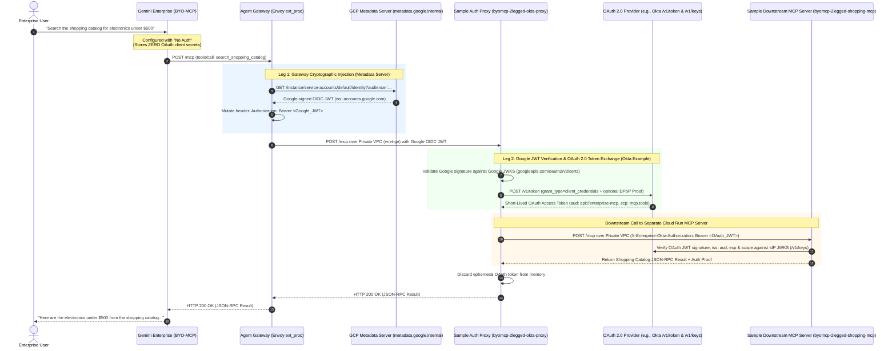

# Gemini Enterprise BYO-MCP: 2-Legged OAuth & Token Exchange Integration

[](https://cloud.google.com/products/agent-gateway)
[](https://cloud.google.com/gemini)
[](https://www.envoyproxy.io/)
[-007dc1.svg)](#supported-oauth-20--oidc-providers)

A production-grade architectural pattern and reference implementation for integrating **Gemini Enterprise Bring Your Own MCP (BYO-MCP)** with internal enterprise MCP servers gated by **any OAuth 2.0 / OIDC-compliant Identity Provider** (such as **Okta**, **Microsoft Entra ID**, **Ping Identity**, **Auth0**, **Keycloak**, or an internal **RFC 8693 STS**) without storing customer OAuth secrets in Google Cloud.

> **Note on the Reference Example:** This repository uses **Okta** (`byomcp-2legged-okta-proxy` and `byomcp-2legged-shopping-mcp`) as the concrete end-to-end reference implementation, but the pattern is 100% standards-based and works with **any OAuth 2.0-compliant provider**.

---

## 🎯 Executive Problem & Objectives

### Standard BYO-MCP vs. The 2-Legged Proxy Pattern
* **Standard Pattern:** Gemini Enterprise BYO-MCP out-of-the-box expects the cloud to store OAuth client secrets (`client_id`, `client_secret`) and manage upstream authentication tokens.
* **The 2-Legged Proxy + Downstream MCP Pattern (This Solution):**
  1. **Hop #1 (Google Cloud Side — Metadata Server & Service Extension):** Gemini Enterprise is configured with **"No Auth"** (plain JSON-RPC). Egress traffic passes through Google Cloud's **Agent Gateway**, where an Envoy `ext_proc` Service Extension dynamically mints and injects a signed **Google Cloud OIDC ID Token** from the **GCP Metadata Server** (`metadata.google.internal`) using the Service Extension's Service Account.
  2. **Hop #2 (Enterprise Proxy Side — OAuth 2.0 Token Exchange):** The **Sample Auth Proxy (`byomcp-2legged-okta-proxy`)** on Cloud Run validates the Google OIDC signature against Google's public JWKS, then performs a live **2-Legged OAuth (`client_credentials`) Token Exchange** with the customer's **OAuth 2.0 Identity Provider** (demonstrated here with **Okta**) to obtain a short-lived **Access Token** (`scp: ["mcp.tools"]`).
  3. **Downstream Call (Separate OAuth-Gated MCP Server on Cloud Run / Private GKE):** The Proxy calls out over the private VPC (`vnet-ge`) to a **separate MCP Server on Cloud Run (`byomcp-2legged-shopping-mcp`)** (or Private GKE), passing the OAuth Access Token. The downstream MCP server cryptographically verifies the JWT against the **IdP's public JWKS endpoint**, executes the shopping tool, and returns the result while the Proxy immediately discards the ephemeral token from memory.

---

## 🔌 Supported OAuth 2.0 / OIDC Providers

Because this architecture relies strictly on standard **OAuth 2.0 (`client_credentials` / RFC 6749, RFC 8693 Token Exchange, and RFC 9449 DPoP)** and **OpenID Connect JWKS (`jwks_uri`)**, customers can use **any OAuth-compliant provider** by configuring three standard endpoints:

| OAuth 2.0 / OIDC Provider | Token Endpoint (`OKTA_TOKEN_URL` / `IDP_TOKEN_URL`) | Public JWKS Endpoint (`jwksUri`) |
| :--- | :--- | :--- |
| **Okta** *(Repo Reference Example)* | `https://<domain>.okta.com/oauth2/<authServerId>/v1/token` | `https://<domain>.okta.com/oauth2/<authServerId>/v1/keys` |
| **Microsoft Entra ID (Azure AD)** | `https://login.microsoftonline.com/<tenantId>/oauth2/v2.0/token` | `https://login.microsoftonline.com/<tenantId>/discovery/v2.0/keys` |
| **Ping Identity (PingFederate / PingOne)** | `https://<ping-host>/as/token.oauth2` | `https://<ping-host>/pf/JWKS` |
| **Auth0** | `https://<tenant>.auth0.com/oauth/token` | `https://<tenant>.auth0.com/.well-known/jwks.json` |
| **Keycloak / ForgeRock / Custom STS** | `https://<idp-host>/realms/<realm>/protocol/openid-connect/token` | `https://<idp-host>/realms/<realm>/protocol/openid-connect/certs` |

---

## 🏛️ Architecture Overview



---

## 🧩 Key Components

| Component | Service / Directory | Technology | Role |
| :--- | :--- | :--- | :--- |
| **Gemini Enterprise** | Discovery Engine BYO-MCP | Google Cloud BYO-MCP | Configured with `No Auth`. Emits standard JSON-RPC tool calls to the Proxy without holding any customer OAuth secrets. |
| **Agent Gateway & Service Extension** | [`service-extension/`](service-extension/) | Python, gRPC, Envoy `ext_proc` v3 | Intercepts egress requests, queries the GCP Metadata Server (`metadata.google.internal`), and injects `Authorization: Bearer <Google_JWT>`. |
| **Sample Auth Proxy** | [`byomcp-2legged-okta-proxy/`](byomcp-2legged-okta-proxy/) | Node.js Express on Cloud Run (`--ingress=internal`, `--vpc-egress=all-traffic`) | Verifies incoming Google OIDC tokens against Google JWKS, exchanges them with your **OAuth 2.0 Provider** (shown with **Okta**) for an Access Token, and calls out to the separate downstream MCP server. |
| **Enterprise OAuth 2.0 IdP** | Okta *(or Entra ID, Ping, Auth0, etc.)* | OAuth 2.0 `client_credentials` (+ optional RFC 9449 DPoP) | Issues short-lived, scoped (`mcp.tools`) JWT access tokens to the Auth Proxy and publishes public signing keys via its JWKS endpoint. |
| **Sample Downstream MCP Server** | [`byomcp-2legged-shopping-mcp/`](byomcp-2legged-shopping-mcp/) | Node.js Express on Cloud Run (`--ingress=internal`) or Private GKE | Separate MCP server hosting the enterprise **Shopping Tools**. Strictly rejects any request without a valid OAuth JWT verified against the IdP's JWKS endpoint. |

---

## 📂 Repository Structure

```text
byomcp-2legged-oauth/
├── service-extension/              # 1. Agent Gateway Envoy ext_proc & Metadata Server token injector
│   ├── enterprise_ext_proc.py      # Core gRPC server minting Google OIDC tokens from Metadata Server
│   ├── authz-extension.yaml        # GCP Network Services AuthzExtension declaration
│   ├── authz-policy.yaml           # GCP Network Security AuthzPolicy declaration
│   ├── deploy.sh                   # Automated build & deploy script for Cloud Run
│   ├── Dockerfile                  # Container definition for ext_proc service
│   ├── requirements.txt            # Python dependencies (grpcio, xds-protos, etc.)
│   ├── test_client.py              # Envoy callout simulator
│   └── test_end_to_end.py          # Local 5-stage verification test suite
├── byomcp-2legged-okta-proxy/      # 2. Sample Edge Auth Proxy (Google OIDC -> OAuth IdP [Okta] -> Downstream MCP)
│   ├── index.js                    # Verifies Google JWT, performs 2LO token exchange, calls downstream MCP
│   ├── package.json                # Dependencies (express, jsonwebtoken, jwks-rsa)
│   └── Dockerfile                  # Container definition for Cloud Run Proxy
├── byomcp-2legged-shopping-mcp/    # 3. Sample Separate OAuth-Gated MCP Server on Cloud Run (Okta Example)
│   ├── index.js                    # Verifies OAuth JWT via JWKS & serves Shopping MCP tools
│   ├── package.json                # Dependencies (express, jsonwebtoken, jwks-rsa)
│   └── Dockerfile                  # Container definition for Downstream Shopping MCP Server
├── mock-server/                    # Local-only single-process mock server for offline testing
│   ├── server.js
│   ├── package.json
│   └── Dockerfile
├── docs/                           # Detailed architecture & sequence documentation
│   └── architecture-guide.md       # Comprehensive architectural deep-dive
└── README.md                       # Main documentation
```

---

## 🔐 1. Metadata Server & Service Extension (`service-extension/`)

The Service Extension (`enterprise-extproc`) runs as an Envoy `ext_proc` gRPC callout attached to your Agent Gateway. Whenever Gemini Enterprise makes an outbound MCP call:
1. `enterprise_ext_proc.py` queries the local **GCP Metadata Server** using its attached Service Account:
   ```text
   http://metadata.google.internal/computeMetadata/v1/instance/service-accounts/default/identity?audience=https://byomcp-2legged-okta-proxy-...
   ```
2. It injects the resulting Google-signed OIDC ID Token into `Authorization: Bearer <Google_JWT>` before the request enters your private VPC (`vnet-ge`).

To deploy the Service Extension:
```bash
cd service-extension
chmod +x deploy.sh
./deploy.sh
```

---

## 🔄 2. Token Exchange Logic (Google OIDC $\rightarrow$ OAuth 2.0 Provider [Okta Example])

Inside [`byomcp-2legged-okta-proxy/index.js`](byomcp-2legged-okta-proxy/index.js), the proxy bridges Google Cloud identity to your Enterprise OAuth 2.0 Provider (using **Okta** in this example, or any OAuth-compliant `/token` endpoint) in two steps:

### Step A: Verify the Inbound Google OIDC Token
The proxy verifies the incoming token from the Service Extension against Google's public JWKS (`https://www.googleapis.com/oauth2/v3/certs`):
```javascript
const googleJwks = jwksClient({
  jwksUri: 'https://www.googleapis.com/oauth2/v3/certs',
  cache: true,
  rateLimit: true,
});

function verifyGoogleOidcJwt(token) {
  return new Promise((resolve, reject) => {
    jwt.verify(
      token,
      getGoogleSigningKey,
      {
        algorithms: ['RS256'],
        issuer: ['https://accounts.google.com', 'accounts.google.com'],
      },
      (err, decoded) => (err ? reject(err) : resolve(decoded))
    );
  });
}
```

### Step B: Exchange for an OAuth 2.0 Access Token (`client_credentials`)
Once the Google caller is verified, the proxy calls the OAuth 2.0 provider's `/token` endpoint using its `client_id` and `client_secret` (the sample code also includes automatic RFC 9449 **DPoP proof** generation for providers like Okta that enforce sender-constrained tokens):
```javascript
let dpopProof = createDpopProof('POST', OKTA_TOKEN_URL, cachedDpopNonce);
let response = await fetch(OKTA_TOKEN_URL, {
  method: 'POST',
  headers: {
    Accept: 'application/json',
    'Content-Type': 'application/x-www-form-urlencoded',
    Authorization: `Basic ${basicAuth}`,
    DPoP: dpopProof, // Optional for standard Bearer OAuth providers; required when Okta DPoP is enabled
  },
  body: new URLSearchParams({
    grant_type: 'client_credentials',
    scope: 'mcp.tools',
  }).toString(),
});
```

---

## 🛡️ 3. Sample Auth Proxy (`byomcp-2legged-okta-proxy/`)

The Sample Auth Proxy ([`byomcp-2legged-okta-proxy/index.js`](byomcp-2legged-okta-proxy/index.js)) is the endpoint registered in Gemini Enterprise (`https://byomcp-2legged-okta-proxy-<PROJECT_NUMBER>.us-central1.run.app/mcp`).

### Networking Requirements for the Proxy
Because the Proxy is deployed with **`--ingress=internal`** and **`--vpc-egress=all-traffic`** on `vnet-ge`:
1. **Private East-West Call to Downstream MCP Server:** When calling `byomcp-2legged-shopping-mcp` (or a Private GKE MCP server), traffic stays inside `vnet-ge` (via Private Google Access / internal VPC routing), satisfying `--ingress=internal` on the downstream MCP server.
2. **External Call to OAuth Provider (e.g., Okta `/v1/token`):** Traffic to your external OAuth provider routes out through `vnet-ge`'s Cloud Router & **Cloud NAT (`nat-ge`)**.

### Deploying `byomcp-2legged-okta-proxy` to Cloud Run
```bash
# 1. Create a subnet in vnet-ge for Cloud Run Direct VPC Egress (if not already created)
gcloud compute networks subnets create subnet-ge-cloudrun \
  --network=vnet-ge \
  --region=us-central1 \
  --range=192.168.20.0/26 \
  --enable-private-ip-google-access

# 2. Deploy the Sample Auth Proxy (configured with Okta or any OAuth 2.0 provider)
gcloud run deploy byomcp-2legged-okta-proxy \
  --source=./byomcp-2legged-okta-proxy \
  --region=us-central1 \
  --ingress=internal \
  --network=vnet-ge \
  --subnet=subnet-ge-cloudrun \
  --vpc-egress=all-traffic \
  --allow-unauthenticated \
  --set-env-vars="OKTA_ISSUER=https://YOUR_OKTA_DOMAIN.okta.com/oauth2/YOUR_AUTH_SERVER_ID,OKTA_CLIENT_ID=YOUR_OKTA_CLIENT_ID,OKTA_CLIENT_SECRET=YOUR_OKTA_CLIENT_SECRET,OKTA_SCOPE=mcp.tools,DOWNSTREAM_MCP_URL=https://byomcp-2legged-shopping-mcp-PROJECT_NUMBER.us-central1.run.app/mcp"
```

---

## 🛍️ 4. Sample OAuth-Gated MCP Server (`byomcp-2legged-shopping-mcp/`)

The Sample Downstream MCP Server ([`byomcp-2legged-shopping-mcp/index.js`](byomcp-2legged-shopping-mcp/index.js)) runs as a **separate Cloud Run service** (or Private GKE workload) and exposes three **Shopping & Retail MCP Tools**:
* `search_shopping_catalog` — Searches the Enterprise Retail Shopping Catalog by category and max price.
* `get_shopping_order_status` — Retrieves real-time customer order status, carrier tracking, and delivery ETA.
* `check_store_inventory` — Checks live warehouse and retail store inventory levels by SKU.

### How `byomcp-2legged-shopping-mcp` Verifies the OAuth JWT
Every request to `/mcp` is verified against the OAuth provider's public JWKS (`${OKTA_ISSUER}/v1/keys` in the Okta example, or any standard `jwks_uri`) before any MCP method (`initialize`, `tools/list`, `tools/call`) is allowed to execute:
```javascript
const client = jwksClient({
  jwksUri: process.env.JWKS_URI || `${OKTA_ISSUER}/v1/keys`,
  cache: true,
  rateLimit: true,
});

function verifyOktaToken(token) {
  return new Promise((resolve, reject) => {
    jwt.verify(
      token,
      getOktaSigningKey,
      {
        algorithms: ['RS256'],
        issuer: OKTA_ISSUER,
        audience: OKTA_AUDIENCE, // e.g., 'api://enterprise-mcp'
      },
      (err, decoded) => {
        if (err) return reject(err);
        const scopes = Array.isArray(decoded.scp)
          ? decoded.scp
          : typeof decoded.scope === 'string'
          ? decoded.scope.split(' ')
          : [];
        if (REQUIRED_SCOPE && !scopes.includes(REQUIRED_SCOPE)) {
          return reject(new Error(`Missing required scope '${REQUIRED_SCOPE}'`));
        }
        resolve(decoded);
      }
    );
  });
}
```

### Deploying `byomcp-2legged-shopping-mcp` to Cloud Run
```bash
gcloud run deploy byomcp-2legged-shopping-mcp \
  --source=./byomcp-2legged-shopping-mcp \
  --region=us-central1 \
  --ingress=internal \
  --allow-unauthenticated \
  --set-env-vars="OKTA_ISSUER=https://YOUR_OKTA_DOMAIN.okta.com/oauth2/YOUR_AUTH_SERVER_ID,OKTA_AUDIENCE=api://enterprise-mcp,REQUIRED_SCOPE=mcp.tools"
```

---

## 🧪 5. Verifying the Security Boundary & IdP Audit Logs

### A. Verify Direct Calls to `byomcp-2legged-shopping-mcp` Fail Without an OAuth Token
If a caller attempts to invoke `byomcp-2legged-shopping-mcp` directly without going through the OAuth token exchange:
```bash
curl -i -X POST "https://byomcp-2legged-shopping-mcp-PROJECT_NUMBER.us-central1.run.app/mcp" \
  -H "Content-Type: application/json" \
  -d '{"jsonrpc":"2.0","id":1,"method":"tools/list"}'
```
**Result (`HTTP 401 Unauthorized`):**
```json
{
  "jsonrpc": "2.0",
  "id": 1,
  "error": {
    "code": -32001,
    "message": "Unauthorized: Missing Okta token on byomcp-2legged-shopping-mcp"
  }
}
```

### B. Verify Direct Calls With a Google Token (Instead of an IdP OAuth Token) Are Rejected
```bash
curl -i -X POST "https://byomcp-2legged-shopping-mcp-PROJECT_NUMBER.us-central1.run.app/mcp" \
  -H "Authorization: Bearer $(gcloud auth print-identity-token)" \
  -H "X-Enterprise-Okta-Authorization: Bearer $(gcloud auth print-identity-token)" \
  -H "Content-Type: application/json" \
  -d '{"jsonrpc":"2.0","id":1,"method":"tools/list"}'
```
**Result (`HTTP 403 Forbidden`):**
```json
{
  "jsonrpc": "2.0",
  "id": 1,
  "error": {
    "code": -32002,
    "message": "Forbidden by Okta Gate: byomcp-2legged-shopping-mcp only accepts valid Okta tokens (...)"
  }
}
```

### C. Inspecting Token Exchange Events in Your IdP (Okta System Log Example)
In your OAuth provider's audit logs (e.g., **Okta Admin Console** $\rightarrow$ `Reports` $\rightarrow$ `System Log`), filter by your Client ID to view:
* **`Evaluation of OAuth2 access policy : ALLOW`**
* **`OAuth2 access token is granted : SUCCESS`** (with the unique `jti` token ID matching the `okta_auth_proof` returned to Gemini Enterprise).

---

## 🛡️ Security & Compliance Highlights

1. **Zero Secret Residency in Google Cloud:** Gemini Enterprise stores zero enterprise passwords, API keys, or OAuth client secrets.
2. **Works with Any OAuth 2.0 / OIDC Provider:** Out-of-the-box support for **Okta** (including RFC 9449 DPoP), **Microsoft Entra ID**, **Ping Identity**, **Auth0**, **Keycloak**, or any standard OAuth 2.0 token & JWKS provider.
3. **Cryptographic Identity Attestation (Hop #1):** Google OIDC identity assertions are minted by the GCP Metadata Server (`accounts.google.com`) and cryptographically validated via Google JWKS at the Proxy.
4. **Separate OAuth-Gated MCP Server (`byomcp-2legged-shopping-mcp`):** Hosted on an isolated Cloud Run service (`--ingress=internal`) or Private GKE cluster that independently validates OAuth JWTs against the IdP's JWKS endpoint and discards ephemeral tokens immediately after tool execution.
