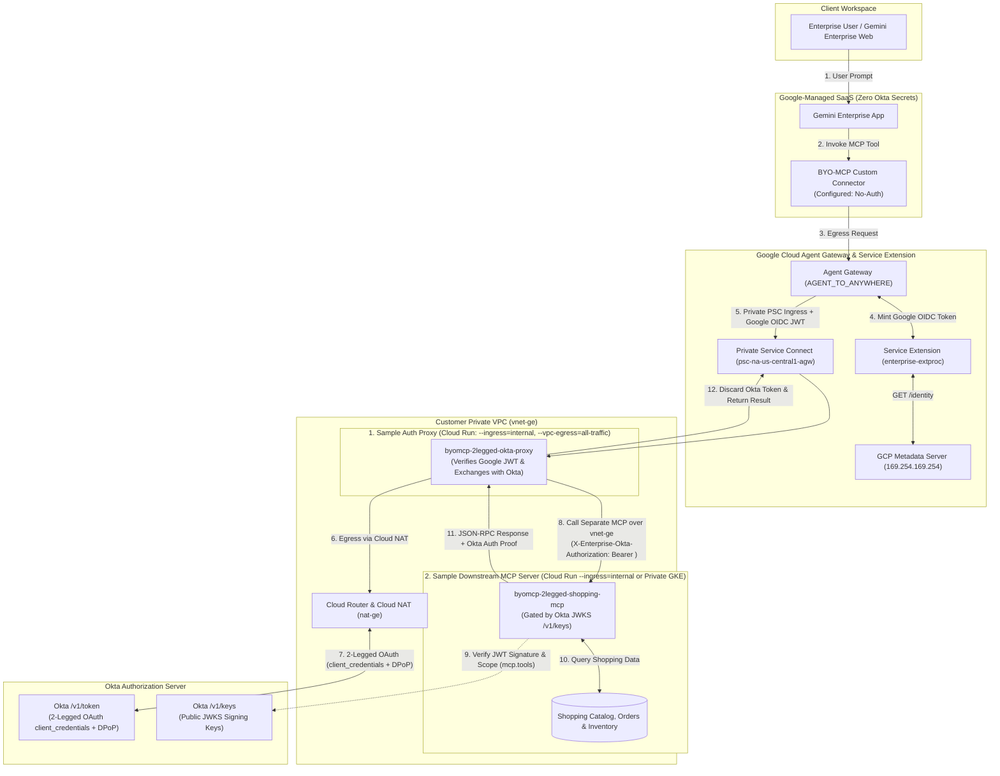
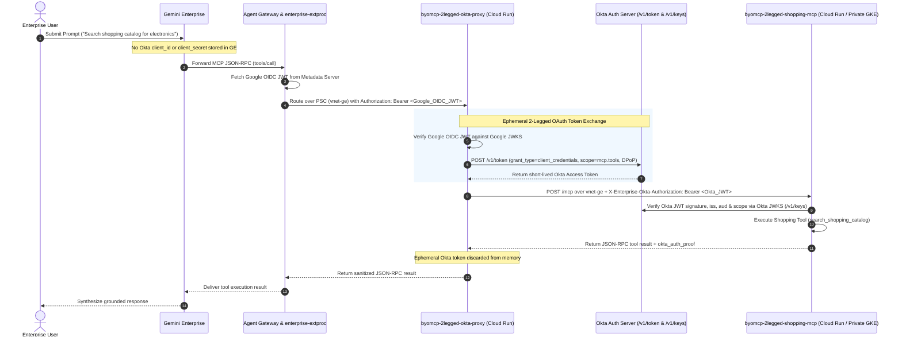

# Technical Architecture & Strategy Proposal
# Secure Bring-Your-Own-MCP (BYO-MCP) Integration for Gemini Enterprise 2-Legged OAuth with Okta
**Date:** October 2026  

---

## 1. Executive Summary

This document evaluates architectural options for enabling **Bring Your Own Model Context Protocol (BYO-MCP)** within **Gemini Enterprise (GE)** for enterprises that require **Okta 2-Legged OAuth (`client_credentials`)** without storing Okta secrets in Google Cloud.

Standard Gemini Enterprise BYO-MCP architecture expects enterprise administrators to register static OAuth 2.0 Client credentials (`client_id`, `client_secret`) within the Google-managed Discovery Engine backend. This conflicts with strict enterprise zero-secret residency policies.

This architecture implements a **Two-Hop 2-Legged OAuth & Token Exchange Pattern** across two separate Cloud Run services (or Cloud Run Proxy $\rightarrow$ Private GKE MCP Server):
1. **Edge Auth Proxy (`byomcp-2legged-okta-proxy`):** Deployed on Cloud Run (`--ingress=internal`, `--vpc-egress=all-traffic`) behind Google Cloud **Private Service Connect (PSC)** and **Agent Gateway**. Gemini Enterprise connects in "No-Auth" mode while the Agent Gateway Service Extension (`enterprise-extproc`) injects a Google OIDC token from the **GCP Metadata Server**. The Proxy verifies the Google OIDC token against Google's JWKS, performs a live **2-Legged OAuth (`client_credentials` + DPoP) token exchange with Okta**, and forwards the MCP request with the resulting Okta Access Token.
2. **Downstream Okta-Gated MCP Server (`byomcp-2legged-shopping-mcp`):** Deployed as a separate Cloud Run service (`--ingress=internal`) or Private GKE service. It rejects any call without a valid Okta token, verifies the Okta JWT against **Okta's JWKS (`/v1/keys`)**, and executes the enterprise **Shopping MCP tools** (`search_shopping_catalog`, `get_shopping_order_status`, `check_store_inventory`).

---

## 2. Customer Security & Compliance Requirements

| ID | Requirement | Rationale / Driver |
| :--- | :--- | :--- |
| **REQ-1** | **Zero Client Secret Storage on GCP Backend** | Enterprise will not store Okta OAuth `client_id` or `client_secret` in Gemini Enterprise or Discovery Engine. |
| **REQ-2** | **Zero Persistent Enterprise Tokens on GCP Backend** | Okta access tokens must never be persisted in Google-managed data stores; they are minted just-in-time and discarded immediately after the MCP call completes. |
| **REQ-3** | **Cryptographic Verification at Every Hop** | The Proxy verifies Google OIDC tokens via Google JWKS (`googleapis.com/oauth2/v3/certs`), and the Downstream MCP Server verifies Okta tokens via Okta JWKS (`/oauth2/<id>/v1/keys`). |
| **REQ-4** | **Private Network Isolation (`vnet-ge` / PSC)** | Both the Proxy and the Downstream MCP Server run with `--ingress=internal` inside the private VPC (`vnet-ge`), with east-west traffic routed privately over Direct VPC Egress (`--vpc-egress=all-traffic`). |
| **REQ-5** | **Decoupled Okta Token Exchange** | Token acquisition occurs just-in-time via `byomcp-2legged-okta-proxy` using Okta `client_credentials` + RFC 9449 DPoP proof. |

---

## 3. Current State vs. 2-Legged Proxy Architecture

### 3.1 Standard Gemini Enterprise BYO-MCP Architecture (GCP Baseline)
In the default Gemini Enterprise Custom MCP Connector setup:
* **Admin Setup:** Admin enters MCP Server URL, Token URL, `Client ID`, and `Client Secret` into the Gemini Enterprise Console.
* **Conflict with Enterprise Policy:** Enterprise does not permit external SaaS storage of internal Okta OAuth client secrets.

### 3.2 Two-Hop 2-Legged OAuth Architecture (`byomcp-2legged-okta-proxy` $\rightarrow$ `byomcp-2legged-shopping-mcp`)
* **2-Legged Hop #1 (Google Cloud Side):** Service Extension (`enterprise-extproc`) $\leftrightarrow$ GCP Metadata Server (`169.254.169.254`) produces a Google OIDC JWT.
* **2-Legged Hop #2 (Enterprise Proxy Side):** `byomcp-2legged-okta-proxy` $\leftrightarrow$ Okta Authorization Server (`/oauth2/<id>/v1/token`) produces a scoped Okta Access Token (`scp: ["mcp.tools"]`).
* **Downstream Execution:** `byomcp-2legged-okta-proxy` calls the separate `byomcp-2legged-shopping-mcp` service over the private VPC (`vnet-ge`).

---

## 4. Architecture & Sequence Diagrams

### 4.1 High-Level Architecture Diagram

---

### 4.2 End-to-End Sequence Flow

---

### 4.3 Cloud Run & VPC Network Configuration Summary

| Service | Cloud Run Ingress | VPC Network & Egress | Purpose |
| :--- | :--- | :--- | :--- |
| **`byomcp-2legged-okta-proxy`** | `--ingress=internal` | `--network=vnet-ge` `--subnet=subnet-ge-cloudrun` `--vpc-egress=all-traffic` | Accepts private PSC traffic from Gemini Enterprise, reaches Okta via Cloud NAT (`nat-ge`), and calls `byomcp-2legged-shopping-mcp` privately inside `vnet-ge`. |
| **`byomcp-2legged-shopping-mcp`** | `--ingress=internal` | Internal VPC boundary (`vnet-ge`) | Rejects public internet traffic at the network layer and rejects non-Okta tokens at the application layer via Okta JWKS (`/v1/keys`). |
