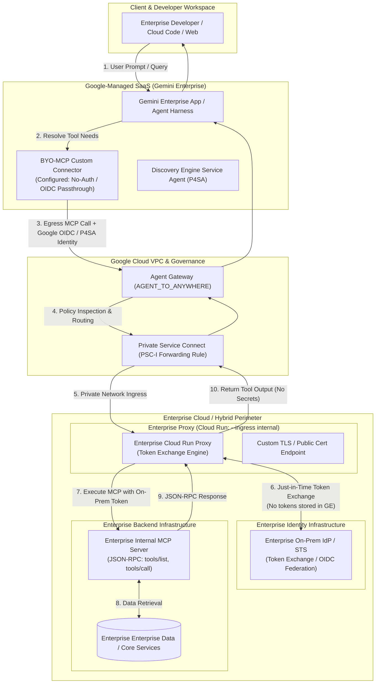
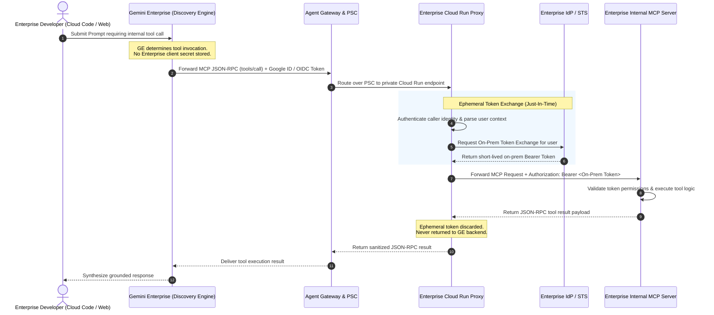

# Technical Architecture & Strategy Proposal
# Secure Bring-Your-Own-MCP (BYO-MCP) Integration for Gemini Enterprise 2legged OAUTH
**Date:** September 2026  

---

## 1. Executive Summary

This document evaluates architectural options for enabling **Bring Your Own Model Context Protocol (BYO-MCP)** within **Gemini Enterprise (GE)** and **Cloud Code / Developer IDEs** for Enterprise.

Standard Gemini Enterprise BYO-MCP architecture expects enterprise administrators to register static OAuth 2.0 Web Client credentials (`client_id`, `client_secret`) and store user authorization tokens (access/refresh tokens) within the Google-managed Discovery Engine backend. This conflicts with Enterprise’s enterprise security policies.

This document proposes and contrasts two primary architectural solutions:
1. **Option 1 (Proxy-Mediated PSC Architecture - Recommended Near-Term):** Deploy Cloud Run Proxy as a private endpoint behind Google Cloud **Private Service Connect (PSC)** and **Agent Gateway**. Gemini Enterprise connects in a "No-Auth" / identity-propagating egress mode; the proxy intercepts the MCP payload, performs real-time token exchange against an external Security Token Service (STS) / Identity Provider (IdP), and forwards authorized MCP JSON-RPC calls (`initialize`, `tools/list`, `tools/call`) to Enterprise's private MCP servers.

---

## 2. Customer Security & Compliance Requirements

| ID | Requirement | Rationale / Driver |
| :--- | :--- | :--- |
| **REQ-1** | **Zero Client Secret Storage on GCP Backend** | Enterprise will not store internal MCP server OAuth client secrets in Gemini Enterprise, Discovery Engine, or third-party SaaS backends. |
| **REQ-2** | **Zero Persistent User On-Prem Tokens on GCP Backend** | On-premise user access tokens and long-lived refresh tokens must never reside or be cached in Google-managed data stores. |
| **REQ-3** | **Per-User Identity & Audit Accountability** | MCP tool invocations must execute with the distinct identity and least-privilege permissions of the invoking user, not a shared system-level service account. |
| **REQ-4** | **Private Network Isolation (VPC-SC / PSC)** | Tool execution traffic must transit private, non-routable IP interconnects without traversing the public internet. |
| **REQ-5** | **Decoupled Token Exchange** | Token acquisition and validation must occur just-in-time via Enterprise’s trusted token exchange proxy. |

---

## 3. Current State vs. Standard Gemini Enterprise BYO-MCP Flow

### 3.1 Standard Gemini Enterprise BYO-MCP Architecture (GCP Baseline)
In the default Gemini Enterprise Custom MCP Connector setup:
* **Admin Setup:** Admin enters MCP Server URL, Authorization URL, Token URL, `Client ID`, and `Client Secret` into the Gemini Enterprise Console.
* **User Authentication:** When a developer triggers an MCP tool, they undergo a standard 3-Legged OAuth (3LO) consent flow.
* **Token Storage:** Gemini Enterprise backend (`vertexaisearch.cloud.google.com`) stores the resulting `refresh_token` and `access_token` in Google-managed storage to perform automated refreshes and attach `Authorization: Bearer <token>` to outbound tool calls.
* **Conflict with Enterprise Policy:** Enterprise does not permit external SaaS storage of internal OAuth client secrets or on-prem user tokens.

---

## 4. Customer-Managed Cloud Run Proxy via Agent Gateway & PSC

### 4.1 Architecture Overview
In this pattern, Gemini Enterprise routes all tool interactions through **Agent Gateway** configured in `AGENT_TO_ANYWHERE` egress mode. The target destination is a private Google Cloud VPC reachable via **Private Service Connect (PSC)**.

Enterprise’s Cloud Run Proxy acts as the gateway target:
1. **Network Boundary:** Cloud Run is configured with `--ingress=internal` behind an Internal Application Load Balancer (ILB) / PSC Service Attachment, ensuring zero public internet exposure.
2. **Gemini Enterprise Auth Configuration:** The BYO-MCP connector is configured in "No Auth" / Identity Passthrough mode. GE transmits an ephemeral Google OIDC / End-User identity token in the request header.
3. **Token Exchange at Proxy:** The Cloud Run proxy receives the request, validates the caller’s Google Identity / IAM context, invokes Enterprise’s on-prem/internal Security Token Service (STS) to exchange the identity for a short-lived on-prem user token, injects the Bearer token, and executes the MCP call against the backend MCP server.

### 4.2 Architecture Diagram

---

### 4.3 End-to-End Sequence Flow

---

### 4.4 Technical Details & Configuration Parameters

#### Cloud Run Ingress & IAM Settings
To allow the proxy to receive Google-propagated tokens without rejected handshakes:
* **Ingress Boundary:** `--ingress=internal` to restrict all traffic strictly to internal VPC and PSC attachments.
* **Authentication Configuration:** Set `--allow-unauthenticated` on Cloud Run’s native infrastructure proxy so that custom headers and downstream authentication tokens are forwarded to the container application rather than intercepted by default Google Accounts IAM.

#### Network Routing via PSC
* Provision a **PSC Service Attachment** pointing to the Cloud Run proxy's Internal Load Balancer.
* In the Agent Gateway project, create a **PSC-I (Interface) / Forwarding Rule** pointing to the Enterprise Service Attachment.
* Configure Cloud DNS Private Peering for `*.run.app` or Enterprise's internal domain.

---
*Document prepared for Enterprise Enterprise Architecture and Google Cloud AI Engineering.*
