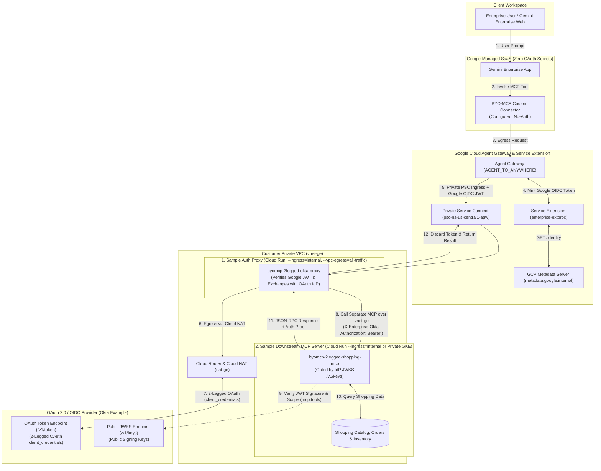
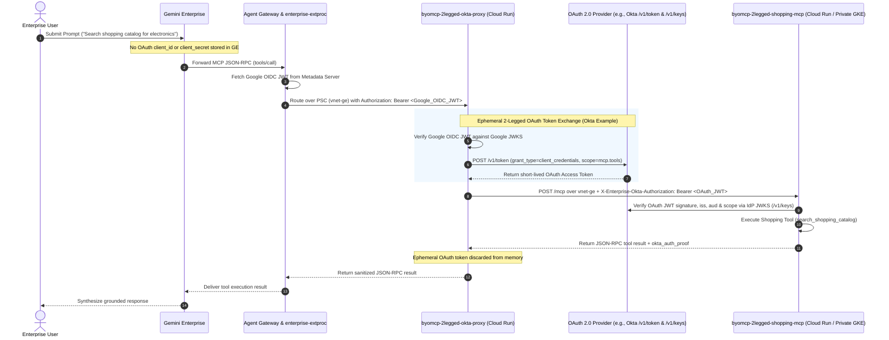

# Technical Architecture & Strategy Proposal
# Secure Bring-Your-Own-MCP (BYO-MCP) Integration for Gemini Enterprise 2-Legged OAuth
**Date:** October 2026  

---

## 1. Executive Summary

This document evaluates architectural options for enabling **Bring Your Own Model Context Protocol (BYO-MCP)** within **Gemini Enterprise (GE)** for enterprises that require **2-Legged OAuth (`client_credentials` / Token Exchange)** with their own **OAuth 2.0 / OIDC-compliant Identity Provider** (such as **Okta**, **Microsoft Entra ID**, **Ping Identity**, **Auth0**, **Keycloak**, or an internal **RFC 8693 STS**) without storing OAuth client secrets in Google Cloud.

Standard Gemini Enterprise BYO-MCP architecture expects enterprise administrators to register static OAuth 2.0 Client credentials (`client_id`, `client_secret`) within the Google-managed Discovery Engine backend.

This architecture implements a **Two-Hop 2-Legged OAuth & Token Exchange Pattern** across two separate Cloud Run services (or Cloud Run Proxy $\rightarrow$ Private GKE MCP Server), using **Okta** as the concrete reference implementation:
1. **Edge Auth Proxy (`byomcp-2legged-okta-proxy`):** Deployed on Cloud Run (`--ingress=internal`, `--vpc-egress=all-traffic`) behind Google Cloud **Private Service Connect (PSC)** and **Agent Gateway**. Gemini Enterprise connects in "No-Auth" mode while the Agent Gateway Service Extension (`enterprise-extproc`) injects a Google OIDC token from the **GCP Metadata Server** (`metadata.google.internal`). The Proxy verifies the Google OIDC token against Google's JWKS, performs a live **2-Legged OAuth (`client_credentials`) token exchange** with the customer's OAuth 2.0 Provider (demonstrated with **Okta**), and forwards the MCP request with the resulting OAuth Access Token.
2. **Downstream OAuth-Gated MCP Server (`byomcp-2legged-shopping-mcp`):** Deployed as a separate Cloud Run service (`--ingress=internal`) or Private GKE service. It rejects any call without a valid OAuth token, verifies the JWT against the **IdP's public JWKS endpoint** (e.g., Okta `/v1/keys`), and executes the enterprise **Shopping MCP tools** (`search_shopping_catalog`, `get_shopping_order_status`, `check_store_inventory`).

---

## 2. Customer Security & Compliance Requirements

| ID | Requirement | Rationale / Driver |
| :--- | :--- | :--- |
| **REQ-1** | **Zero Client Secret Storage on GCP Backend** | Enterprise will not store internal OAuth `client_id` or `client_secret` in Gemini Enterprise or Discovery Engine. |
| **REQ-2** | **Zero Persistent Enterprise Tokens on GCP Backend** | Enterprise OAuth access tokens must never be persisted in Google-managed data stores; they are minted just-in-time and discarded immediately after the MCP call completes. |
| **REQ-3** | **Standards-Based OAuth 2.0 / OIDC Compatibility** | Must support any OAuth 2.0 / OIDC-compliant provider (Okta, Microsoft Entra ID, Ping Identity, Auth0, Keycloak) via standard `/token` and `jwks_uri` endpoints. |
| **REQ-4** | **Private Network Isolation (`vnet-ge` / PSC)** | Both the Proxy and the Downstream MCP Server run with `--ingress=internal` inside the private VPC (`vnet-ge`), with east-west traffic routed privately over Direct VPC Egress (`--vpc-egress=all-traffic`). |
| **REQ-5** | **Decoupled Token Exchange** | Token acquisition occurs just-in-time via the customer-managed proxy (`byomcp-2legged-okta-proxy`) using standard OAuth 2.0 `client_credentials` (with optional RFC 9449 DPoP proof). |

---

## 3. Using Any OAuth 2.0 / OIDC Provider (With Okta as the Reference Example)

While the sample services in this repository are named `byomcp-2legged-okta-proxy` and `byomcp-2legged-shopping-mcp` and pre-configured for **Okta**, the code uses standard `fetch` (for `/token`) and `jsonwebtoken` + `jwks-rsa` (for JWKS verification). Any OAuth 2.0-compliant provider can be plugged in via environment variables:

| Provider | Token URL (`OKTA_TOKEN_URL`) | JWKS URL (`JWKS_URI`) | Scope Claim |
| :--- | :--- | :--- | :--- |
| **Okta** *(Reference Example)* | `https://<org>.okta.com/oauth2/<id>/v1/token` | `https://<org>.okta.com/oauth2/<id>/v1/keys` | `scp` (Array) |
| **Microsoft Entra ID** | `https://login.microsoftonline.com/<tenant>/oauth2/v2.0/token` | `https://login.microsoftonline.com/<tenant>/discovery/v2.0/keys` | `scp` or `roles` |
| **Ping Identity** | `https://<ping-host>/as/token.oauth2` | `https://<ping-host>/pf/JWKS` | `scope` (String / Array) |
| **Auth0 / Keycloak** | `https://<host>/oauth/token` | `https://<host>/.well-known/jwks.json` | `scope` (Space-delimited string) |

---

## 4. Architecture & Sequence Diagrams

### 4.1 High-Level Architecture Diagram

---

### 4.2 End-to-End Sequence Flow

---

### 4.3 Cloud Run & VPC Network Configuration Summary

| Service | Cloud Run Ingress | VPC Network & Egress | Purpose |
| :--- | :--- | :--- | :--- |
| **`byomcp-2legged-okta-proxy`** | `--ingress=internal` | `--network=vnet-ge` `--subnet=subnet-ge-cloudrun` `--vpc-egress=all-traffic` | Accepts private PSC traffic from Gemini Enterprise, reaches the OAuth 2.0 Provider (e.g., Okta) via Cloud NAT (`nat-ge`), and calls `byomcp-2legged-shopping-mcp` privately inside `vnet-ge`. |
| **`byomcp-2legged-shopping-mcp`** | `--ingress=internal` | Internal VPC boundary (`vnet-ge`) | Rejects public internet traffic at the network layer and rejects non-IdP tokens at the application layer via OAuth JWKS verification. |
